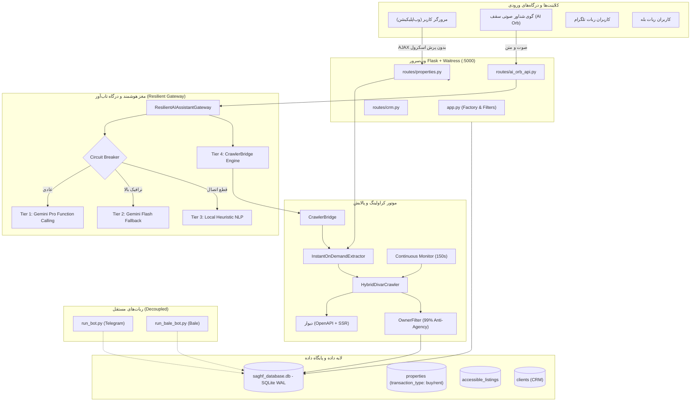

# 🏛️ سند مرجع جامع، کامل و یکپارچه انتقال پروژه سقف برای کدکس (Saghf Codex Master Handoff)

> **توجه برای هوش مصنوعی، مدل‌های پایه و کدکس (Codex / Claude / GPT / Gemini):**  
> این سند یک فایل **کاملاً مستقل، خودکفا و تجمیع‌شده (All-In-One Self-Contained Document)** از کل پروژه سامانه هوشمند «سقف» است. تمام نیازمندی‌ها، اسکیماها، لاجیک‌های فیلترینگ، درگاه هوش مصنوعی، ساختار فرانت‌اند، قوانین غیرقابل‌تغییر و دستورات اجرایی در این تک‌فایل گردآوری شده‌اند تا برای ادامه توسعه در کدکس نیازی به بررسی فایل‌های جانبی نباشد.

---

## فهرست مندرجات
1. [هویت، مأموریت و ارکان بنیادین سیستم](#۱-هویت-مأموریت-و-ارکان-بنیادین-سیستم)
2. [معماری کلان، جریان داده‌ها و دیاگرام جامع](#۲-معماری-کلان-جریان-دادهها-و-دیاگرام-جامع)
3. [نقشه ساختار دایرکتوری و مسئولیت ماژول‌ها](#۳-نقشه-ساختار-دایرکتوری-و-مسئولیت-ماژولها)
4. [طراحی پایگاه داده، اسکیماها و مدل‌های SQLAlchemy](#۴-طراحی-پایگاه-داده-اسکیماها-و-مدلهای-sqlalchemy)
5. [موتور کراولینگ هیبریدی دیوار، استخراج On-Demand و فیلترهای مالکین](#۵-موتور-کراولینگ-هیبریدی-دیوار-استخراج-on-demand-و-فیلترهای-مالکین)
6. [درگاه هوش مصنوعی ۴ سطحی و پل ارتباطی CrawlerBridge](#۶-درگاه-هوش-مصنوعی-۴-سطحی-و-پل-ارتباطی-crawlerbridge)
7. [معماری فرانت‌اند، UX بدون پرش اسکرول و طراحی Neon Dark](#۷-معماری-فرانتاند-ux-بدون-پرش-اسکرول-و-طراحی-neon-dark)
8. [معماری ربات‌های مستقل (Decoupled Telegram & Bale Bots)](#۸-معماری-رباتهای-مستقل-decoupled-telegram--bale-bots)
9. [مستندات کامل اندپوینت‌های API و قراردادهای تبادل داده](#۹-مستندات-کامل-اندپوینتهای-api-و-قراردادهای-تبادل-داده)
10. [دفترچه راهنمای عملیاتی و پروتکل اجرای دستورات (Runbook)](#۱۰-دفترچه-راهنمای-عملیاتی-و-پروتکل-اجرای-دستورات-runbook)
11. [منشور راهبری تغییرناپذیر، خطوط قرمز و قوانین AGENTS.md](#۱۱-منشور-راهبری-تغییرناپذیر-خطوط-قرمز-و-قوانین-agentsmd)

---

## ۱. هویت، مأموریت و ارکان بنیادین سیستم

سامانه **«سقف» (Saghf Real Estate OS & Intelligence)** پلتفرم جامع پردازش، فایلینگ اختصاصی و هوش مصنوعی معاملات ملکی در کلان‌شهر تهران (با تمرکز ویژه بر مناطق ۲ و ۵) است.

### ارکان بنیادین سیستم:
1. **استخراج مستقیم آگهی‌های مالکین واقعی:** حذف واسطه‌ها و پنل‌های املاکی با دقت بالای ۹۹٪ با استفاده از تحلیل معنایی متن و شناسایی نشانه‌های اصالت مالک شخصی.
2. **استخراج درلحظه و آرشیو ۷ روز اخیر (۱۶۸ ساعت):** اتصال آنی به دیوار به محض جستجوی متقاضی (On-demand Live Crawling) در کنار بهره‌برداری کامل از تاریخچه یک هفته اخیر.
3. **تفکیک قطعی و بدون نشت انواع معامله:** جداسازی ریاضی و داده‌ای رهن و اجاره (`rent`) از خرید و فروش (`buy`) در سطح مدل، اعتبارسنجی مالی و کوئری‌های SQL.
4. **تضمین اصالت و شفافیت ارجاع:** الزام درج تگ مستقیم `<a href="..." target="_blank">لینک آگهی</a>` و شماره تماس استعلام‌شده مالک در تمام کارت‌ها و پاسخ‌های صوتی و متنی.
5. **معماری ربات‌های مستقل (Decoupled):** استقلال چرخه حیات ربات‌های تلگرام و بله از سرور وب‌اپلیکیشن (صرفاً اشتراک دیتابیس SQLite).
6. **درگاه هوش مصنوعی چندسطحی و بدون ادعای پوچ:** استقلال منطق پایه از مدل‌های خارجی، به طوری که دستیار هرگز به کاربر وعده «در آینده ثبت می‌کنم» ندهد و همواره فایل‌های واقعی و کارشناسی‌شده تحویل دهد.

---

## ۲. معماری کلان، جریان داده‌ها و دیاگرام جامع



---

## ۳. نقشه ساختار دایرکتوری و مسئولیت ماژول‌ها

| مسیر فایل یا پوشه | مسئولیت اصلی و کارکرد در سیستم |
|---|---|
| `app.py` | ساخت اپلیکیشن Flask، رجیستر Blueprintها، فیلترهای قالب Jinja، مایگریشن خودکار و ترد پایش مداوم دیوار |
| `run_server.py` | اجرای وب‌سرور صنعتی Waitress روی پورت ۵۰۰۰ با ۱۶ نخ موازی و کش رم دیتابیس ۶۴MB |
| `config.py` | پیکربندی متغیرهای محیطی، اتصال دیتابیس SQLite، کلیدهای دسترسی و حساب ادمین |
| `AGENTS.md` | اساسنامه منشور راهبری، خطوط قرمز و قوانین توسعه خودمختار ایجنت |
| `database/models.py` | مدل‌های داده رابطه‌ای (`Property`, `AccessibleListing`, `Owner`, `Client`, `Visit`, `MatchRecord`, ...) |
| `database/migration_manager.py` | مایگریشن خودکار اسکیماهای دیتابیس (مانند ستون و ایندکس `transaction_type`) |
| `crawler/hybrid_divar.py` | کراولر هیبریدی دیوار (اندپوینت OpenAPI Finder + استخراج SSR HTML با سشن ضد بلاک) |
| `crawler/owner_filter.py` | فیلتر حذف واسطه‌ها، محافظ عبارات «مشاورین تماس نگیرند» و فیلتر کهنگی ۷ روزه |
| `crawler/publisher_classifier.py` | دسته‌بندی نوع ناشر (`likely_owner`, `likely_intermediary`, `explicit_agency`) |
| `crawler/schemas.py` | مدل Pydantic (`NormalizedPropertySchema`) همراه با اعتبارسنجی صفرسازی متضاد مالی |
| `crawler/continuous_monitor.py` | ترد پس‌زمینه پایش مداوم مناطق ۲ و ۵ تهران در فواصل ۱۵۰ ثانیه‌ای |
| `crawler/dedup.py` | موتور حذف فایل‌های تکراری با کش دو سطحی حافظه و دیتابیس |
| `services/on_demand_extractor.py` | سرویس استخراج زنده درلحظه (On-Demand Scrape) به محض جستجوی کاربر یا دستیار |
| `services/assistant/gateway.py` | درگاه ۴ سطحی دستیار هوشمند با مدارشکن و تضمین تحویل فایل‌های واقعی |
| `services/assistant/crawler_bridge.py` | پل اتصال دستیار به کراولر، آرشیو ۷ روزه، تگ لینک مستقیم و ساختار دوتایی پاسخ |
| `services/assistant/memory_manager.py` | مدیریت نشست‌ها، دیالوگ‌های چندمرحله‌ای و ذخیره پارامترهای مشتری (`CustomerCriteria`) |
| `services/matching_service.py` | موتور تطبیق هوشمند دوطرفه ملک با تقاضای مشتریان CRM بر پایه امتیاز بالای ۸۰٪ |
| `services/scoring_service.py` | سیستم ارزش‌گذاری املاک، نمره‌دهی جذابیت و محاسبه انطباق طلایی |
| `services/voice_agent_service.py` | پایپلاین کنترل مکالمه صوتی و تولید پاسخ‌های هوشمند صوتی گوی شناور |
| `services/tts_service.py` | تبدیل متن به صوت با صدای فارسی فرید مایکروسافت (Edge TTS) |
| `routes/properties.py` | ویترین املاک، فیلتر ایجکس، استخراج درجا (`/api/on-demand-search`) و پولینگ زنده |
| `routes/ai_orb_api.py` | کنترلر گوی شناور هوش مصنوعی (`/api/ai-orb/...`) |
| `routes/crm.py` | مدیریت پایپلاین کانبان، ثبت لاگ تماس‌ها، زمان‌بندی بازدیدها |
| `templates/properties/list.html` | صفحه لیست املاک با لودینگ اسکلتون، فیلتر بدون پرش اسکرول و کارت‌های ۳ بعدی |
| `run_bot.py` | اسکریپت اجرای ربات تلگرام (مستقل از وب‌اپ) |
| `run_bale_bot.py` | اسکریپت اجرای ربات پیام‌رسان بله (مستقل از وب‌اپ) |

---

## ۴. طراحی پایگاه داده، اسکیماها و مدل‌های SQLAlchemy

دیتابیس سیستم از **SQLite** در حالت **WAL (Write-Ahead Logging)** همراه با کش همگام ۶۴ مگابایتی و نگاشت حافظه (mmap_size) بهره می‌برد.

### ۱. مدل ملک رسمی دفتر (`Property`):
```python
class Property(db.Model):
    __tablename__ = 'properties'

    id = db.Column(db.Integer, primary_key=True)
    file_code = db.Column(db.String(20), unique=True, index=True)
    title = db.Column(db.String(200), nullable=False)
    
    # تفکیک قطعی و سنتی نوع معامله
    deal_type = db.Column(db.String(20), nullable=False, index=True) # 'sale' | 'rent'
    transaction_type = db.Column(db.String(20), nullable=True, index=True) # 'buy' | 'rent'
    
    # مشخصات مالی (اعتبارسنجی صفرسازی متضاد)
    total_price = db.Column(db.BigInteger, nullable=True) # برای رهن/اجاره اجباراً 0
    meter_price = db.Column(db.BigInteger, nullable=True) # برای رهن/اجاره اجباراً 0
    deposit = db.Column(db.BigInteger, nullable=True)     # برای فروش اجباراً 0
    monthly_rent = db.Column(db.BigInteger, nullable=True)# برای فروش اجباراً 0
    
    # مشخصات فیزیکی و مکانی
    area = db.Column(db.Integer, nullable=False, index=True)
    rooms = db.Column(db.Integer, default=1)
    district = db.Column(db.String(100), nullable=False, index=True)
    city = db.Column(db.String(50), default='تهران')
    address = db.Column(db.String(300))
    floor = db.Column(db.Integer, nullable=True)
    build_year = db.Column(db.Integer, nullable=True)
    
    # امکانات اصلی
    has_parking = db.Column(db.Boolean, default=False)
    has_elevator = db.Column(db.Boolean, default=False)
    has_warehouse = db.Column(db.Boolean, default=False)
    has_balcony = db.Column(db.Boolean, default=False)
    
    # اصالت و منبع
    source = db.Column(db.String(50), default='divar') # 'divar' | 'sheypoor' | 'direct_owner'
    source_url = db.Column(db.String(500), nullable=True)
    source_id = db.Column(db.String(100), nullable=True, index=True)
    is_personal_owner = db.Column(db.Boolean, default=True, index=True)
    status = db.Column(db.String(30), default='active', index=True) # 'active', 'sold', 'archived', 'needs_followup'
    
    owner_id = db.Column(db.Integer, db.ForeignKey('owners.id'), nullable=True)
    created_at = db.Column(db.DateTime, default=datetime.utcnow, index=True)
```

### ۲. مدل آرشیو آگهی‌های دسترسی‌پذیر (`AccessibleListing`):
رکوردهای پردازش‌شده و کراول‌شده از دیوار به همراه متادیتای خام، برچسب نوع ناشر (`publisher_type`: `likely_owner`, `likely_intermediary`, `explicit_agency`) و ستون ایندکس‌شده `transaction_type`.

### ۳. اعتبارسنجی مالی Pydantic (`crawler/schemas.py`):
```python
def validate_and_sanitize_financials(cls, values):
    d_type = values.get('deal_type')
    t_type = values.get('transaction_type') or ('rent' if d_type == 'rent' else 'buy')
    
    if d_type == 'rent' or t_type == 'rent':
        values['total_price'] = 0
        values['meter_price'] = 0
        values['transaction_type'] = 'rent'
    elif d_type in ('sale', 'buy') or t_type == 'buy':
        values['deposit'] = 0
        values['monthly_rent'] = 0
        values['transaction_type'] = 'buy'
    return values
```

---

## ۵. موتور کراولینگ هیبریدی دیوار، استخراج On-Demand و فیلترهای مالکین

### ۱. معماری کراولر ترکیبی (`HybridDivarCrawler`):
کراولر دو مسیر پردازشی برای دریافت داده دارد:
1. **مسیر ۱ (OpenAPI Finder):** استعلام از اندپوینت پلتفرم باز دیوار (`https://open-api.divar.ir/v2/open-platform/finder/post`). در صورت وجود نشست، داده ساختاریافته فوری دریافت می‌شود.
2. **مسیر ۲ (SSR HTML Scraper با سشن انعطاف‌پذیر):** ارسال درخواست به آدرس استاندارد وب `divar.ir/s/tehran/{slug}/{district}` با هدرهای مرورگر کروم دسکتاپ و پارس متغیرهای `__INITIAL_STATE__` و تک‌تک کارت‌های آگهی.

### ۲. فیلترینگ واسطه‌ها و بنگاه‌ها (`OwnerFilter`):
* **کلمات ممنوعه صریح واسطه‌ای:**  
  `املاک، املاکی، املاك، مسکن، مسكن، مشاور، مشاوره، آژانس، دپارتمان، بنگاه، کارشناس`
* **محافظت از عبارات سلب تماس مشاورین (Disclaimer Patterns):**  
  اگر در متنی عباراتی نظیر «مشاورین محترم تماس نگیرند»، «همکاران املاک تماس نگیرند» یا «مالک هستم» وجود داشته باشد، سیستم کلمه «مشاور» یا «املاک» را فیلتر نمی‌کند؛ بلکه آن را سند قطعی **مالک شخصی** تلقی می‌نماید.
* **فیلتر اسکان اشتراکی (Shared Housing):**  
  حذف ۱۰۰٪ آگهی‌های دارای کلیدواژه‌های «همخونه، همخانه، اسکان اشتراکی، تخت، خوابگاه».
* **پوشش آرشیو ۷ روز اخیر:**  
  آگهی‌های ثبت‌شده از لحظاتی پیش تا ۷ روز گذشته (۱۶۸ ساعت) پذیرفته می‌شوند و تنها آگهی‌های با برچسب بالای ۷ روز (مانند «۸ روز پیش»، «۲ هفته پیش») به عنوان منقضی رد می‌گردند.

### ۳. استخراج درلحظه (`InstantOnDemandExtractor`):
به محض استعلام کاربر یا دستور صوتی دستیار، متد `scrape_and_persist_live` اجرا می‌شود تا بدون انتظار برای زمان‌بندی‌های دوره‌ای، آگهی‌های ثبت‌شده دقایق اخیر دیوار را فوراً اسکرپ کرده، به دیتابیس تزریق کند و مستقیماً روی صفحه قرار دهد.

---

## ۶. درگاه هوش مصنوعی ۴ سطحی و پل ارتباطی CrawlerBridge

کلاس `ResilientAIAssistantGateway` در [gateway.py](file:///c:/saghf%20سقف/services/assistant/gateway.py) پایداری دائمی دستیار را با معماری چندسطحی تضمین می‌کند:

```
[درخواست کاربر] ───► [ResilientAIAssistantGateway]
                           │
             ┌─────────────┴─────────────┐
             ▼                           ▼
      [Circuit Closed]            [Circuit Open]
             │                           │
    ┌────────┴────────┐                  │
    ▼                 ▼                  ▼
[Tier 1: Gemini]  [Tier 2: Flash]   [Tier 3: Local NLP]
    │                 │                  │
    └────────┬────────┘                  ▼
             ▼                   [Tier 4: CrawlerBridge]
      (در صورت خطا/تایم‌اوت)          (100% مستقل و آفلاین)
```

### شرح سطوح چهارگانه:
1. **Tier 1 (Gemini 1.5/2.0 Pro):** درک عمیق معنایی، استخراج پارامترهای ملکی و اجرای Function Calling برای جستجوی املاک یا ثبت قرار بازدید.
2. **Tier 2 (Gemini 1.5 Flash):** سوئیچ اتوماتیک در صورت بروز خطای ترافیکی (۵۰۳) یا سهمیه با حفظ تمام پارامترها.
3. **Tier 3 (Local Heuristic NLP):** کلاسیفایر محلی با سرعت اجرای زیر ۱۵ میلی‌ثانیه برای احوالپرسی‌های اولیه و درخواست مستقیم بازدید با کد فایل بدون ارسال ریکوئست خارجی.
4. **Tier 4 (CrawlerBridge Baseline Engine):** مسیر پایه ۱۰۰٪ مستقل و آفلاین. کوئری مستقیماً به دیتابیس و کراولر زنده متصل می‌شود.

### قوانین عملیاتی `CrawlerBridge` (ماده ۷ اساسنامه سقف):
* **تفکیک بازه پویا:** محاسبه بازه متراژ دقیق (مثلاً ۷۵ تا ۹۰ متر) و بازه گسترده (مثلاً ۷۰ تا ۱۰۰ متر).
* **ساختار دوتایی پاسخ در چت:**
  - **بخش اول (فایل‌های منطبق دقیق):** ۱۵ تا ۲۰ آگهی کاملاً منطبق، مرتب‌شده از تازه‌ترین زمان ثبت (اولویت ۱: ۲ تا ۳۰ دقیقه پیش، اولویت ۲: ساعات گذشته تا ۷ روز).
  - **بخش دوم (پیشنهادات هوشمند):** ۵ تا ۱۰ آگهی جذاب در همان محدوده با شرایط و قیمت نزدیک، همراه با دلیل کوتاه پیشنهاد (مثلاً «متراژ نزدیک با نقشه عالی»).
* **الزام تگ لینک و شماره تماس:**  
  تک‌تک آیتم‌ها دارای `<a href="..." target="_blank" rel="noopener noreferrer">لینک آگهی</a>` و شماره تماس استعلام‌شده مالک هستند.
* **مکانیزم Relaxation Fallback:**  
  در صورتی که با فیلترهای فوق‌العاده سخت‌گیرانه نتیجه‌ای یافت نشود، کراولر به صورت خودکار نزدیک‌ترین فایل‌های معتبر ۷ روز اخیر را به عنوان پیشنهاد تحویل می‌دهد تا صفحه خالی نماند و هرگز ادعای «در آینده ثبت می‌کنم» تولید نشود.

---

## ۷. معماری فرانت‌اند، UX بدون پرش اسکرول و طراحی Neon Dark

### ۱. سیستم طراحی (Neon Dark Glassmorphism):
* پس‌زمینه عمیق تاریک با افکت‌های بلور شیشه‌ای (`backdrop-filter: blur(16px)`).
* پالت رنگی حرفه‌ای: لهجه‌های نئون فیروزه‌ای (`#06b6d4`) برای خرید/فروش، کهربایی (`#f59e0b`) برای رهن/اجاره، بنفش نئون (`#a855f7`) برای هوش مصنوعی.
* تایپوگرافی راست‌چین (RTL) استاندارد با فونت محبوب وزیرمتن (Vazirmatn).
* فیزیک کارت‌های سه‌بعدی با چرخش بر اساس موقعیت ماوس (3D Specular Glare).

### ۲. رفع مشکل پرش اسکرول و رفرش صفحه (Zero Scroll Reset):
* **مهار پیش‌فرض فرم:** شناسه فرم `propertiesFilterForm` به متد `e.preventDefault()` مجهز شده است.
* **ایجکس بلادرنگ (`triggerOnDemandSearch`):** داده‌ها از اندپوینت `/properties/api/on-demand-search` به صورت پس‌زمینه خوانده شده و کانتینر کارت‌ها بدون رفرش یا ری‌ماونت بازسازی می‌شود.
* **حفظ اسکرول:** موقعیت اسکرول کاربر (`window.scrollY`) قبل از فراخوانی ثبت و پس از دریافت داده تثبیت می‌گردد.
* **اسکلتون لودینگ درجا:** در زمان ارسال درخواست، انیمیشن شیمر اسکلتون در همان محل کارت‌ها نمایش می‌یابد تا ارتفاع صفحه به هم نریزد.
* **سوئیچ تب‌ها و چیپ‌های سریع:** کلیک روی چیپ‌ها یا تب‌های معامله بدون لود مجدد صفحه، جستجوی ایجکس را برای همان تب فعال می‌کند.

---

## ۸. معماری ربات‌های مستقل (Decoupled Telegram & Bale Bots)

مطابق ماده ۴.۲ اساسنامه معماری پروژه:
* **استقلال کامل فرآیند اجرایی:**  
  ربات تلگرام ([run_bot.py](file:///c:/saghf%20سقف/run_bot.py)) و ربات بله ([run_bale_bot.py](file:///c:/saghf%20سقف/run_bale_bot.py)) دارای چرخه حیات، ترد و فرآیند اجرایی کاملاً مستقل از وب‌اپلیکیشن هستند.
* **عدم وابستگی وب‌اپ:**  
  سرور وب‌اپلیکیشن بدون نیاز به اجرای بات‌ها با ۱۰۰٪ توانایی بالا می‌آید و قطعی یا فیلترینگ تلگرام هیچ اثری روی وب‌سایت ندارد.
* **نقطه اشتراک:**  
  ارتباط بات‌ها با سیستم صرفاً از طریق خواندن رکوردهای تأییدشده از دیتابیس مشترک `saghf_database.db` و ثبت متقاضیان صورت می‌پذیرد.

---

## ۹. مستندات کامل اندپوینت‌های API و قراردادهای تبادل داده

### ۱. اندپوینت جستجوی درلحظه و فیلتر (`GET, POST /properties/api/on-demand-search`)
* **پارامترهای ورودی:**  
  `deal_type` (`sale` / `rent` / `all`), `district`, `min_area`, `max_area`, `min_price`, `max_price`, `min_deposit`, `max_deposit`, `min_rent`, `max_rent`, `rooms`, `has_parking`, `has_elevator`, `force_crawl` (0 یا 1)
* **پاسخ موفق:**
```json
{
  "status": "found",
  "crawler_running": false,
  "count": 10,
  "items": [
    {
      "id": 142,
      "file_code": "10142",
      "title": "آپارتمان ۸۵ متری پونک ۲ خواب",
      "deal_type": "rent",
      "transaction_type": "rent",
      "district": "پونک",
      "area": 85,
      "rooms": 2,
      "deposit": 800000000,
      "monthly_rent": 15000000,
      "total_price": 0,
      "source_url": "https://divar.ir/v/...",
      "link_tag": "<a href=\"https://divar.ir/v/...\" target=\"_blank\" rel=\"noopener noreferrer\">لینک آگهی</a>",
      "phone_number": "09123456789",
      "time_ago": "لحظاتی پیش",
      "images": ["/static/uploads/..."]
    }
  ]
}
```

### ۲. اندپوینت پولینگ استریم زنده (`GET /properties/api/poll-live`)
* جهت دریافت تدریجی آگهی‌های جدید استخراج‌شده در زمان فعال بودن کراولر در پس‌زمینه.

### ۳. اندپوینت گفتگو با گوی صوتی هوشمند (`POST /api/ai-orb/voice-interact`)
* **ورودی:** `{"command": "آپارتمان ۸۰ متری پونک برای اجاره می‌خواهم", "session_id": "uuid"}`
* **خروجی:**
```json
{
  "success": true,
  "voice_reply": "فایل‌های رهن و اجاره در محله پونک استخراج شد و ۱۵ مورد برتر روی صفحه قرار گرفت.",
  "speech_text": "فایل‌های رهن و اجاره پونک آماده شد.",
  "items": [...],
  "action": "properties_found"
}
```

### ۴. اندپوینت بررسی سلامت سیستم (`GET /api/health`)
* وضعیت سرویس دیتابیس، آپ‌تایم و در دسترس بودن کراولر را گزارش می‌کند.

---

## ۱۰. دفترچه راهنمای عملیاتی و پروتکل اجرای دستورات (Runbook)

### ۱. پیش‌نیازها و محیط اجرا:
* Python 3.11+
* سیستم‌عامل Windows با شل PowerShell (یا سرور Linux با تنظیمات UTF-8)
* فایل متغیرهای محیطی `.env` با تنظیم کلیدها:
  ```env
  FLASK_ENV=production
  SECRET_KEY=your_secret_key
  ADMIN_USERNAME=admin
  ADMIN_PASSWORD=your_secure_password
  DATABASE_URL=sqlite:///saghf_database.db
  GEMINI_API_KEY=your_gemini_key
  ```

### ۲. اجرای وب‌سرور صنعتی سقف (Waitress WSGI):
```powershell
python run_server.py
```
* **آدرس محلی وب‌اپلیکیشن:** `http://127.0.0.1:5000`
* **آدرس پنل مدیریت:** `http://127.0.0.1:5000/admin/login`

### ۳. اجرای بات‌های مستقل (در کنسول‌های جداگانه):
```powershell
# اجرای بات تلگرام
python run_bot.py

# اجرای بات بله
python run_bale_bot.py
```

### ۴. اجرای تست‌های یکپارچگی سیستمی:
```powershell
python -m pytest tests/test_accessible_divar_search.py tests/test_crawler_bridge_assistant.py -v
```

---

## ۱۱. منشور راهبری تغییرناپذیر، خطوط قرمز و قوانین AGENTS.md

این قوانین بر تمامی دستورات و تغییرات آینده حاکم بوده و نقض آن‌ها غیرمجاز است:

1. **کیفیت و اصالت داده‌ها (خط قرمز اول):**  
   استفاده از دیتای ماک، فیک یا هاردکدشده برای آگهی‌های ملکی مطلقاً ممنوع است. تمام داده‌ها باید از کراولر یا پایگاه‌داده واقعی استخراج شوند.
2. **الزام تگ مستقیم لینک آگهی:**  
   تمام داده‌های کراول‌شده باید دارای لینک مستقیم و تگ صریح `<a href="..." target="_blank" rel="noopener noreferrer">لینک آگهی</a>` و شماره تماس استعلام‌شده مالک باشند.
3. **تفکیک معماری بات‌ها:**  
   فرآیند تست، توسعه و اجرای وب‌اپلیکیشن کاملاً مستقل از ربات‌های تلگرام و بله است و وب‌اپلیکیشن نباید هیچ وابستگی اجرایی به اتصال یا فعال بودن بات‌ها داشته باشد.
4. **ممنوعیت پرسش‌های میانی و خودمختاری کامل:**  
   ایجنت موظف است تمام مراحل پیاده‌سازی، ویرایش فایل‌ها، اجرای تست‌ها، رفع ارورها و اعتبارسنجی را بدون توقف و بدون پرسیدن «آیا ادامه دهم؟» تا رسیدن به نتیجه نهایی و تست‌شده به صورت مستقل به پایان برساند.
5. **جداسازی قطعی رهن از خرید:**  
   هیچ آگهی فروشی نباید با برچسب رهن و هیچ آگهی رهنی نباید با برچسب خرید در دیتابیس ذخیره شود یا در تب‌های متضاد نمایش داده شود.
6. **ممنوعیت عبارات تعویقی در دستیار:**  
   دستیار هوشمند تحت هیچ شرایطی نباید پاسخ‌هایی مانند «در آینده آگهی آمد ثبت می‌کنم» بدهد؛ در هر استعلام باید کراول درلحظه یا آرشیو ۷ روز اخیر بازخوانی شده و فایل‌های واقعی به کاربر ارائه شوند.
7. **ایمنی ترمینال و گیت:**  
   دستورات مخرب نظیر `git reset --hard`، `git push --force` یا پاک‌سازی دیتابیس بدون بکاپ اکیداً ممنوع هستند.
